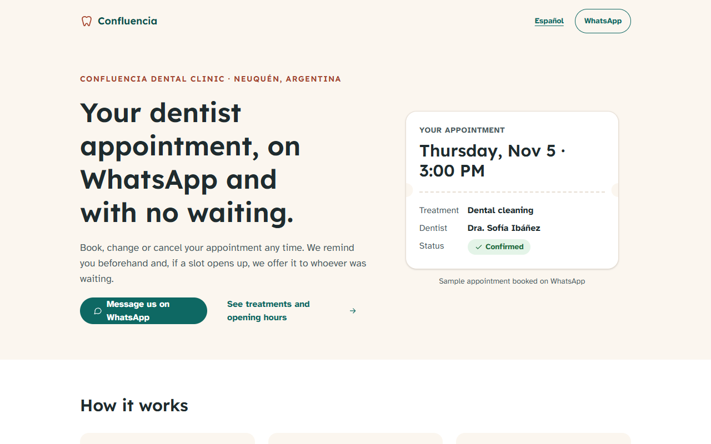
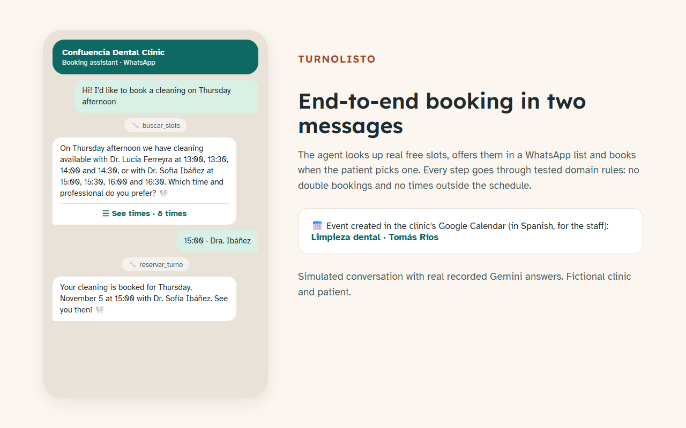
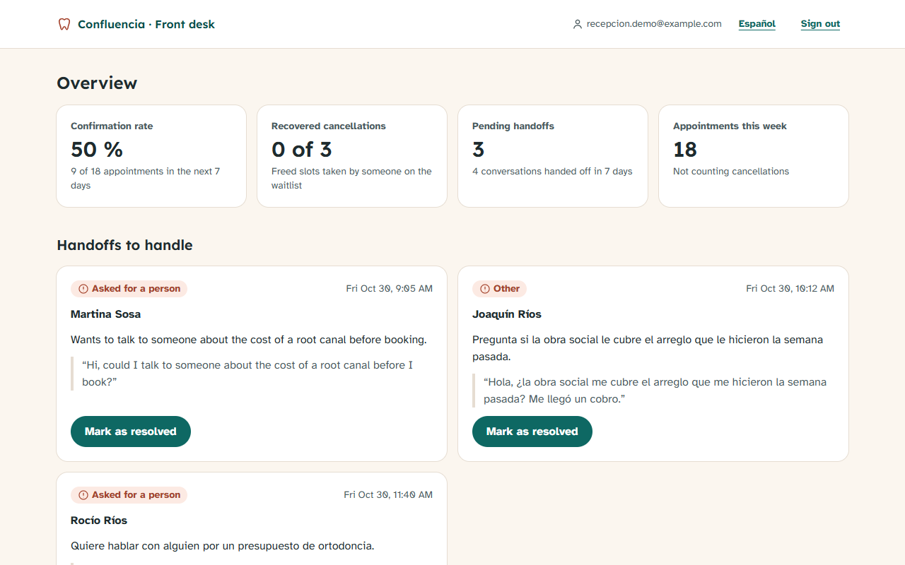
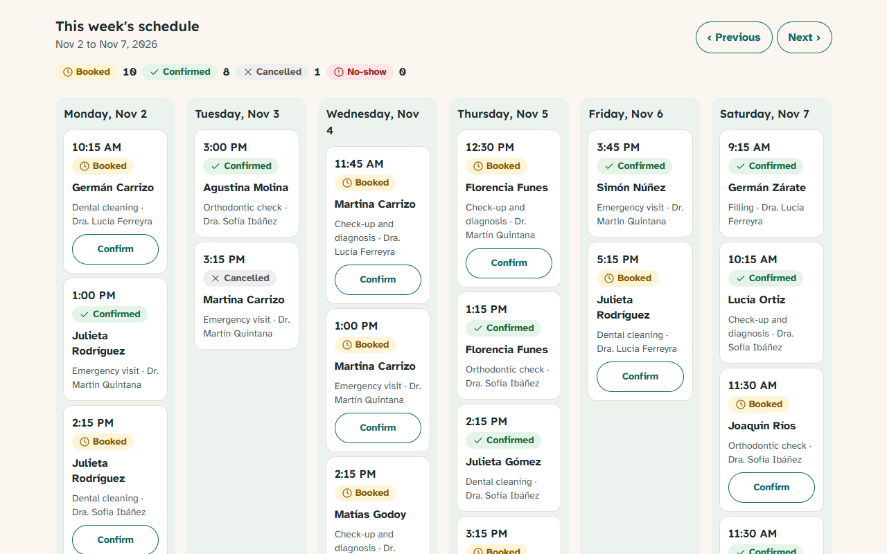
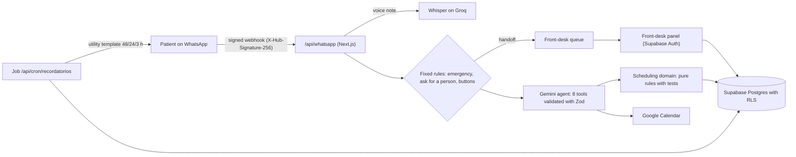

# TurnoListo · WhatsApp appointment agent for a dental clinic

**Books, reschedules and cancels appointments over WhatsApp, sends reminders 48 h, 24 h and 3 h before, and fills gaps from a waitlist.**


[Versión en español](README.md)

> **Demo project.** "Clínica Dental Confluencia" is a fictional brand and all data (patients, phone numbers, prices,
> insurers) is made up. It is not a real client. The bot answers in Rioplatense Spanish (Argentina) or in English,
> depending on how the patient writes, and the site and the panel have English versions (`/en`, `/en/panel`).

## The problem

A dental clinic loses appointments to last-minute cancellations and no-shows. The front desk spends the day answering
"do you have anything on Thursday?" on WhatsApp, and freed-up slots stay empty.

## The solution

- **WhatsApp agent** that understands text and voice notes, finds real free slots, books, reschedules and cancels
  (asking for confirmation), and answers prices, insurers and opening hours **only from the clinic's own data**.
- **Reminders 48 h, 24 h and 3 h before** with "Confirm / Reschedule" buttons. The button confirms without going through the AI.
- **Waitlist:** when someone cancels, the slot is offered over WhatsApp to the first person it fits.
- **Human handoff** for emergencies (severe pain, bleeding, swelling), requests to talk to someone, complaints or two
  messages in a row it can't understand. The bot stays quiet until the front desk resolves it.
- **Front-desk panel:** confirmation rate for the next 7 days, recovered cancellations, handoff queue and weekly schedule.

## Demo

- Video: _to be recorded_ (script in [docs/video/guion.md](docs/video/guion.md), in Spanish).
- Try it without Meta or a phone: `npm run simular -- reservar` sends the conversation to the webhook, signed exactly like Meta signs it.

| | |
|---|---|
|  |  |
|  |  |

## Architecture



**Decisions that matter:**

- **Critical paths don't depend on the AI.** Emergencies, "I want to talk to a person" and reminder buttons are handled
  by fixed rules, before the model.
- **The model never touches data.** It calls tools whose arguments are validated with Zod. Every booking goes through the
  domain (`src/domain/agenda.ts`): no double booking for the dentist or the patient, inside opening hours, on the slot
  grid and outside holidays.
- **The database defends itself too.** An `exclude using gist` constraint blocks overlapping appointments even if two messages arrive at once.
- **The final answer is a tool as well** (`responder`), so it comes out validated (text, understood or not, topic) and capped at 3 sentences.
- **Idempotent everywhere.** Each Meta `message_id` is processed once. Each reminder is "claimed" in the database before
  sending and released if sending fails.
- **Deterministic conversation tests.** The 16 conversations ran against the real Gemini and their answers were recorded:
  `npm test` replays them without using quota. `npm run bench` runs them live again.

## Stack and skills

Next.js 16 (App Router, server actions) · strict TypeScript · Tailwind 4 · WhatsApp Cloud API (webhooks, buttons, lists,
templates) · Google Gemini (function calling) · Groq Whisper · Google Calendar API (service account) · Supabase
(Postgres, RLS, Auth) · Vitest · Playwright · axe-core · Lighthouse · Zod · Luxon.

## Run it

```bash
npm install
cp .env.example .env.local          # fill in the keys: each one says where it comes from
npm run check-env                   # OK/MISSING per variable, never prints values
npm run probar-claves               # tests each key with a request that writes nothing
```

1. **Database:** in Supabase, run `supabase/migrations/*.sql` in order (SQL editor), then `npm run db:seed`, which loads
   the fictional data and creates the demo front-desk user.
2. **App:** `npm run dev`, then open http://localhost:3201/en and http://localhost:3201/en/panel (Spanish: `/` and `/panel`).
3. **WhatsApp:** deploy the app (or use a tunnel) and point Meta's webhook to `/api/whatsapp` with `WHATSAPP_VERIFY_TOKEN`.
   In demo mode, `WHATSAPP_DESTINOS_PERMITIDOS` limits which numbers the bot talks to (who it messages and who it answers).
4. **Reminders:** `npm run plantilla` creates the template in Meta. A scheduler calls `GET /api/cron/recordatorios` with
   `Authorization: Bearer CRON_SECRET` (an n8n workflow is ready in `n8n/`).

| Command | What it does |
|---|---|
| `npm test` | Unit, domain and the 16 conversation tests |
| `npm run test:e2e` | Playwright + axe on the production build |
| `npm run lighthouse` | Mobile Lighthouse for `/`, `/panel`, `/en` and `/en/panel` (median of 3) |
| `npm run bench` | Conversations with live Gemini: latency, tokens and cost |
| `npm run simular -- <case>` | One conversation through the webhook, no Meta (`--real` uses live Gemini) |
| `npm run probar-rls` | Checks row-level security against Supabase |
| `npm run resultados` | Collects everything into `docs/resultados/resumen.json` |

## Tests and measured results

Measured in this repo on 2026-10-30 (`docs/resultados/`).

| What was measured | Result |
|---|---|
| Unit, domain and conversation tests (Vitest) | 119/119 |
| Business conversations (recorded Gemini answers; 16 in Spanish, 2 in English) | 18/18 |
| Conversations with live Gemini (`npm run bench`) | 14/14 |
| E2E with Playwright (390 px phone and 1440 px desktop) | 13/13 |
| axe WCAG 2.1 AA (`/`, `/panel/ingresar`, `/panel` and their `/en` versions) | 0 violations |
| Mobile Lighthouse `/` (performance / accessibility / best practices / SEO) | 98 / 100 / 100 / 100 |
| Mobile Lighthouse `/panel` (logged in) | 98 / 100 / 100 / 100 |
| Mobile Lighthouse `/en` and `/en/panel` | 98 / 100 / 100 / 100 |
| Agent latency per message, median (21 messages) | 2.2 s |
| Latency without free-tier waits, median / p95 (18 messages) | 2.1 s / 7.7 s |
| Model calls per message | 2.05 |
| Row-level security: no session / front desk | 0 rows / sees everything, cannot delete |

The test conversations cover: booking, rescheduling, cancelling with confirmation, insurer, price, voice note,
off-topic question, asking for a person, emergency, duplicate Meta delivery, Sunday, waitlist, "Confirm" button,
"Reschedule" button, new patient and a name with ñ and accents.

## Estimated running costs

| Item | Cost |
|---|---|
| Gemini 3.5 Flash-Lite, paid tier (USD 0.30 / 1M input tokens, USD 2.50 / 1M output) | **USD 0.003 per conversation** (measured: ~8,000 input and ~220 output tokens). A full booking: USD 0.0038 |
| Gemini, free tier | USD 0, with a per-minute limit (see Limits) |
| Supabase, Vercel Hobby, Google Calendar | USD 0 on their free plans at this volume |
| Groq Whisper (voice notes) | Groq's per-hour audio rate; not measured |
| WhatsApp | Replies within the 24 h conversation window are free; reminder templates are charged per message at Meta's rate for each country (not measured) |

## WhatsApp compliance 2026

- **A business bot, not a general assistant.** Since 2026-01-15 Meta doesn't allow general-purpose AI chatbots on the
  WhatsApp Business Platform. TurnoListo only handles appointments and clinic questions; for anything else it says so in
  one sentence and doesn't answer (covered by tests).
- **There's always a human.** Handoff to the front desk on request, complaint, emergency or two misunderstandings; the
  bot pauses until the front desk resolves it.
- **Opt-in.** Reminders only go to patients who agreed to WhatsApp (`opt_in_whatsapp`).
- **Utility templates.** Reminders use a *utility* template with quick-reply buttons.
- **Security.** The webhook checks `X-Hub-Signature-256` and answers 401 when it doesn't match. Panel data is protected
  with RLS and only staff can see it.

## Limits and next steps

- On Gemini's free tier, the per-minute limit adds 24–59 s waits during bursts (89 s p95 in the bench). Production uses the paid tier.
- With Supabase in us-west-2 each message adds 2.5–4 s of queries. Next: batch queries or a closer region.
- Tested with a webhook simulator that signs exactly like Meta. A test with the real number on a public URL is still pending.
- The reminder job is ready, but nothing calls it automatically yet (n8n, an external cron or Vercel Pro).
- Reminders (a Meta template) and waitlist offers are still sent in Spanish only; an English template is next.
- Still missing: an email to the front desk on handoff (today it shows in the panel queue) and a permanent WhatsApp token.

## Author

Built by Germán Schouabs.

## License

MIT. See [LICENSE](LICENSE).
