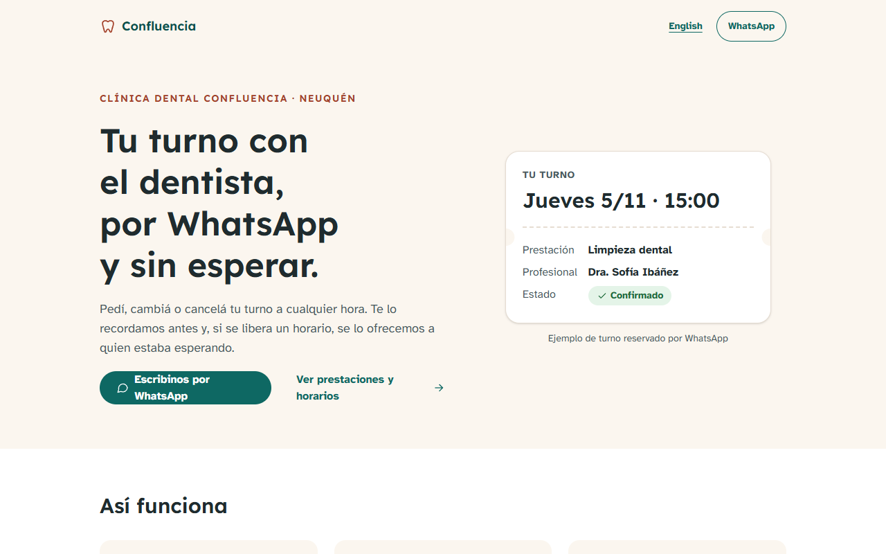
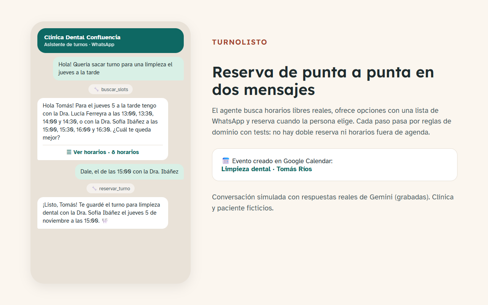
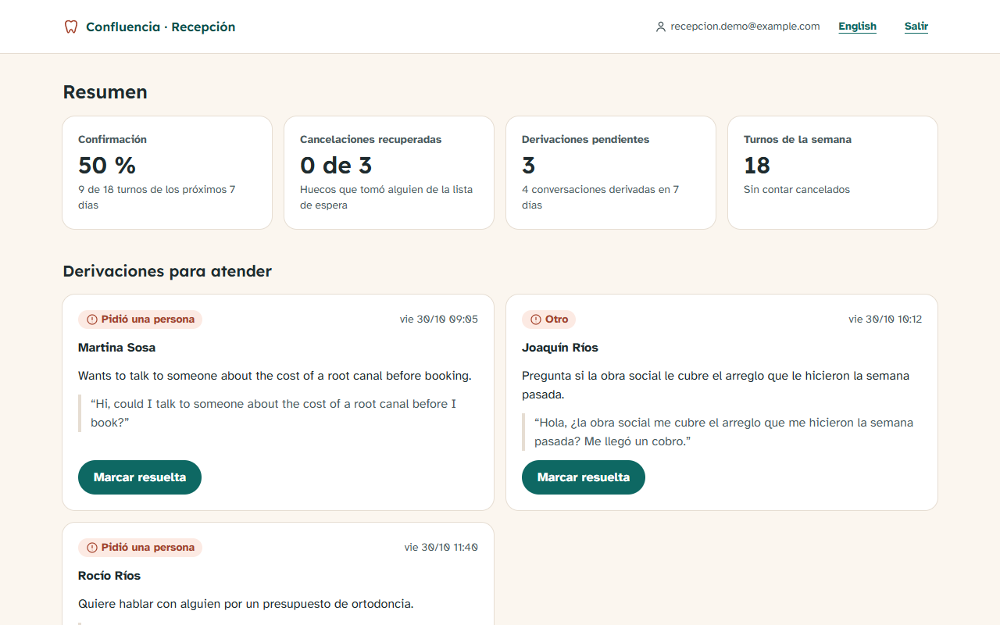
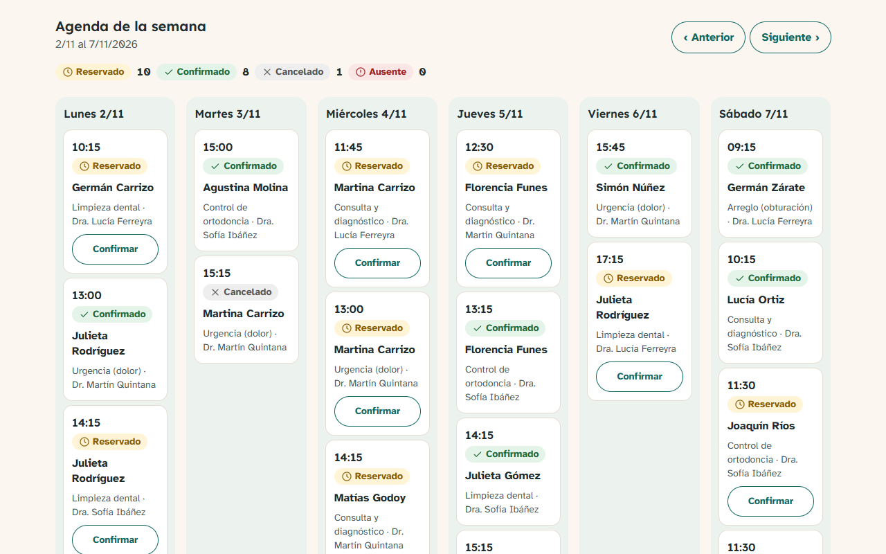
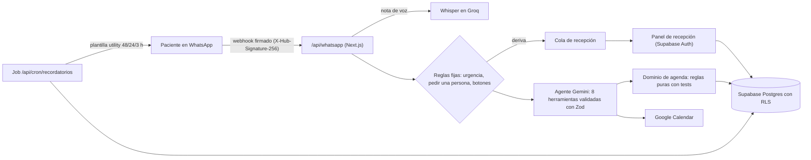

# TurnoListo · Agente de turnos por WhatsApp para una clínica odontológica

**Da, cambia y cancela turnos por WhatsApp, recuerda 48 h, 24 h y 3 h antes y llena los huecos con la lista de espera.**


[English version](README.en.md)

> **Proyecto de demostración.** "Clínica Dental Confluencia" es una marca ficticia y todos los datos (pacientes, teléfonos,
> precios, obras sociales) son inventados. No es un cliente real. El bot contesta en español o en inglés, según
> cómo escriba el paciente, y el sitio y el panel tienen versión en inglés (`/en`, `/en/panel`).

## El problema

Una clínica odontológica pierde turnos por cancelaciones de último momento y por gente que no avisa. Recepción pasa el
día contestando "¿tienen turno el jueves?" por WhatsApp, y los huecos que se liberan quedan vacíos.

## La solución

- **Agente de WhatsApp** que entiende texto y notas de voz, busca horarios libres reales, reserva, reprograma y cancela
  (pidiendo confirmación), y responde precios, obras sociales y horarios **solo desde los datos de la clínica**.
- **Recordatorios a 48 h, 24 h y 3 h** con botones "Confirmo / Reprogramar". El botón confirma sin pasar por la IA.
- **Lista de espera**: cuando alguien cancela, el hueco se le ofrece por WhatsApp al primero que le sirve.
- **Derivación a una persona** ante urgencias (dolor fuerte, sangrado, hinchazón), pedidos de hablar con alguien,
  quejas o dos mensajes que no se entienden. El bot se calla hasta que recepción resuelve.
- **Panel de recepción**: confirmación de los próximos 7 días, cancelaciones recuperadas, cola de derivaciones y agenda semanal.

## Demo

- Video: _pendiente de grabar_ (guion en [docs/video/guion.md](docs/video/guion.md)).
- Probalo sin Meta ni teléfono: `npm run simular -- reservar` manda la conversación al webhook firmado igual que Meta.

| | |
|---|---|
|  |  |
|  |  |

## Arquitectura



**Decisiones que importan:**

- **Lo crítico no depende de la IA.** Urgencias, "quiero hablar con una persona" y los botones del recordatorio se
  resuelven con reglas fijas, antes del modelo.
- **El modelo no toca datos.** Llama herramientas con argumentos validados con Zod. Cada reserva pasa por el dominio
  (`src/domain/agenda.ts`): sin doble reserva del profesional ni del paciente, dentro del horario, en la grilla y fuera de feriados.
- **La base también se defiende.** Una restricción `exclude using gist` impide turnos superpuestos aunque lleguen dos mensajes a la vez.
- **La respuesta final también es una herramienta** (`responder`), así sale validada (texto, si entendió y el tema) y
  con un máximo de 3 oraciones.
- **Idempotencia en todo.** Cada `message_id` de Meta se procesa una sola vez. Cada recordatorio se "reclama" en la
  base antes de mandarse y se libera si el envío falla.
- **Tests de conversación deterministas.** Las 16 conversaciones corrieron contra Gemini de verdad y sus respuestas
  quedaron grabadas: `npm test` las repite sin gastar cuota. `npm run bench` las vuelve a correr en vivo.

## Stack y skills demostradas

Next.js 16 (App Router, server actions) · TypeScript estricto · Tailwind 4 · WhatsApp Cloud API (webhooks, botones,
listas, plantillas) · Google Gemini (function calling) · Groq Whisper · Google Calendar API (cuenta de servicio) ·
Supabase (Postgres, RLS, Auth) · Vitest · Playwright · axe-core · Lighthouse · Zod · Luxon.

## Cómo correrlo

```bash
npm install
cp .env.example .env.local          # completar las claves: cada una dice de dónde sale
npm run check-env                   # OK/FALTA por variable, sin mostrar valores
npm run probar-claves               # prueba cada clave con un pedido que no escribe nada
```

1. **Base:** en Supabase, correr `supabase/migrations/*.sql` en orden (editor SQL) y después `npm run db:seed`, que carga los
   datos ficticios y crea el usuario demo de recepción.
2. **App:** `npm run dev` y abrir http://localhost:3201 y http://localhost:3201/panel.
3. **WhatsApp:** publicar la app (o usar un túnel) y configurar el webhook de Meta en `/api/whatsapp` con `WHATSAPP_VERIFY_TOKEN`.
   En modo demo, `WHATSAPP_DESTINOS_PERMITIDOS` limita con qué números habla el bot (a quién le escribe y a quién le contesta).
4. **Recordatorios:** `npm run plantilla` crea la plantilla en Meta. Un programador llama a `GET /api/cron/recordatorios`
   con `Authorization: Bearer CRON_SECRET` (hay un workflow de n8n listo en `n8n/`).

| Comando | Qué hace |
|---|---|
| `npm test` | Tests de unidad, dominio y las 16 conversaciones |
| `npm run test:e2e` | Playwright + axe sobre el build de producción |
| `npm run lighthouse` | Lighthouse móvil de `/`, `/panel`, `/en` y `/en/panel` (mediana de 3) |
| `npm run bench` | Las conversaciones con Gemini en vivo: latencia, tokens y costo |
| `npm run simular -- <caso>` | Una conversación por el webhook, sin Meta (`--real` usa Gemini en vivo) |
| `npm run probar-rls` | Comprueba la seguridad por filas contra Supabase |
| `npm run resultados` | Junta todo en `docs/resultados/resumen.json` |

## Tests y resultados medidos

Medido en este repo el 30/10/2026 (`docs/resultados/`).

| Qué se midió | Resultado |
|---|---|
| Tests de unidad, dominio y conversaciones (Vitest) | 119/119 |
| Conversaciones de negocio (respuestas de Gemini grabadas; 16 en español y 2 en inglés) | 18/18 |
| Conversaciones con Gemini en vivo (`npm run bench`) | 14/14 |
| E2E con Playwright (celular 390 px y compu 1440 px) | 13/13 |
| axe WCAG 2.1 AA (`/`, `/panel/ingresar`, `/panel` y sus versiones `/en`) | 0 violaciones |
| Lighthouse móvil `/` (rendimiento / accesibilidad / buenas prácticas / SEO) | 98 / 100 / 100 / 100 |
| Lighthouse móvil `/panel` (con sesión) | 98 / 100 / 100 / 100 |
| Lighthouse móvil `/en` y `/en/panel` | 98 / 100 / 100 / 100 |
| Latencia del agente por mensaje, mediana (21 mensajes) | 2,2 s |
| Latencia sin las esperas del plan gratis, mediana / p95 (18 mensajes) | 2,1 s / 7,7 s |
| Llamadas al modelo por mensaje | 2,05 |
| Seguridad por filas: sin sesión / recepción | 0 filas / ve todo, no puede borrar |

Las conversaciones de prueba incluyen: reservar, reprogramar, cancelar con confirmación, obra social, precio, nota de voz,
pregunta fuera de tema, pedir una persona, urgencia, mensaje duplicado de Meta, domingo, lista de espera, botón
"Confirmo", botón "Reprogramar", paciente nuevo y un nombre con ñ y tildes.

## Costos de operación estimados

| Concepto | Costo |
|---|---|
| Gemini 3.5 Flash-Lite, plan pago (USD 0,30 / 1M tokens de entrada, USD 2,50 / 1M de salida) | **USD 0,003 por conversación** (medido: ~8.000 tokens de entrada y ~220 de salida). Una reserva completa: USD 0,0038 |
| Gemini, plan gratis | USD 0, con límite por minuto (ver Límites) |
| Supabase, Vercel Hobby, Google Calendar | USD 0 en sus planes gratuitos para este volumen |
| Groq Whisper (notas de voz) | Según la tarifa de Groq por hora de audio; no se midió |
| WhatsApp | Las respuestas dentro de las 24 h de la conversación no se cobran; las plantillas de recordatorio se cobran por mensaje según la tarifa de Meta para cada país (no medido) |

## Cumplimiento WhatsApp 2026

- **Bot de negocio, no asistente general.** Desde el 15/01/2026 Meta no permite chatbots de IA de propósito general en la
  WhatsApp Business Platform. TurnoListo solo da turnos y responde sobre la clínica; ante otros temas lo dice en una
  oración y no contesta (está en los tests).
- **Siempre hay una persona.** Derivación a recepción por pedido, queja, urgencia o dos fallas de comprensión; el bot se
  pausa hasta que recepción resuelve.
- **Opt-in.** Los recordatorios solo van a pacientes con consentimiento para WhatsApp (`opt_in_whatsapp`).
- **Plantillas utility.** Los recordatorios usan una plantilla de categoría *utility* con botones de respuesta rápida.
- **Seguridad.** El webhook verifica `X-Hub-Signature-256` y responde 401 si no coincide. Los datos del panel están
  protegidos con RLS y solo los ve el personal.

## Límites y próximos pasos

- En el plan gratis de Gemini, el límite por minuto agrega esperas de 24 a 59 s cuando hay ráfagas (p95 de 89 s en el
  bench). En producción va el plan pago.
- Con Supabase en us-west-2 cada mensaje suma 2,5 a 4 s de consultas. Próximo paso: juntar consultas o usar una región más cercana.
- Probado con un simulador de webhooks firmados igual que Meta. Falta la prueba con el número real en una URL pública.
- El job de recordatorios está listo, pero nada lo llama solo todavía (n8n, cron externo o Vercel Pro).
- Los recordatorios (plantilla de Meta) y las ofertas de la lista de espera salen solo en español; falta una plantilla en inglés.
- Falta el aviso por mail a recepción cuando se deriva (hoy queda en la cola del panel) y un token permanente de WhatsApp.

## Autoría

Desarrollado por Germán Schouabs.

## Licencia

MIT. Ver [LICENSE](LICENSE).
